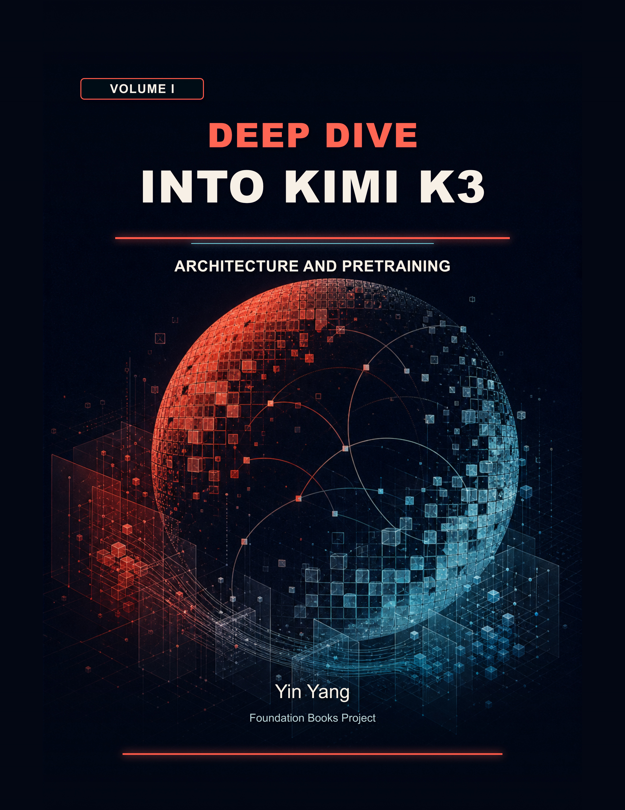
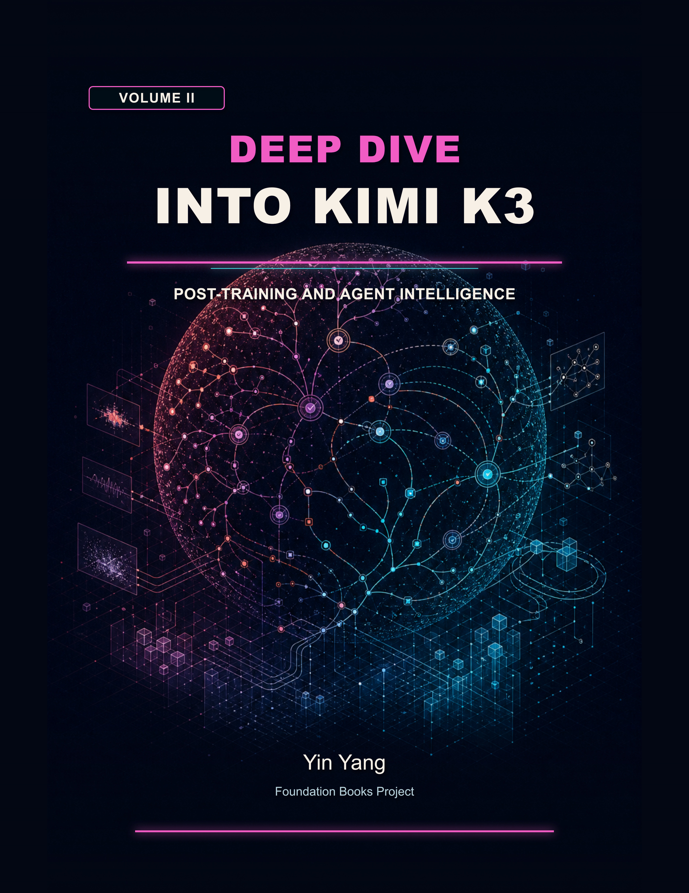
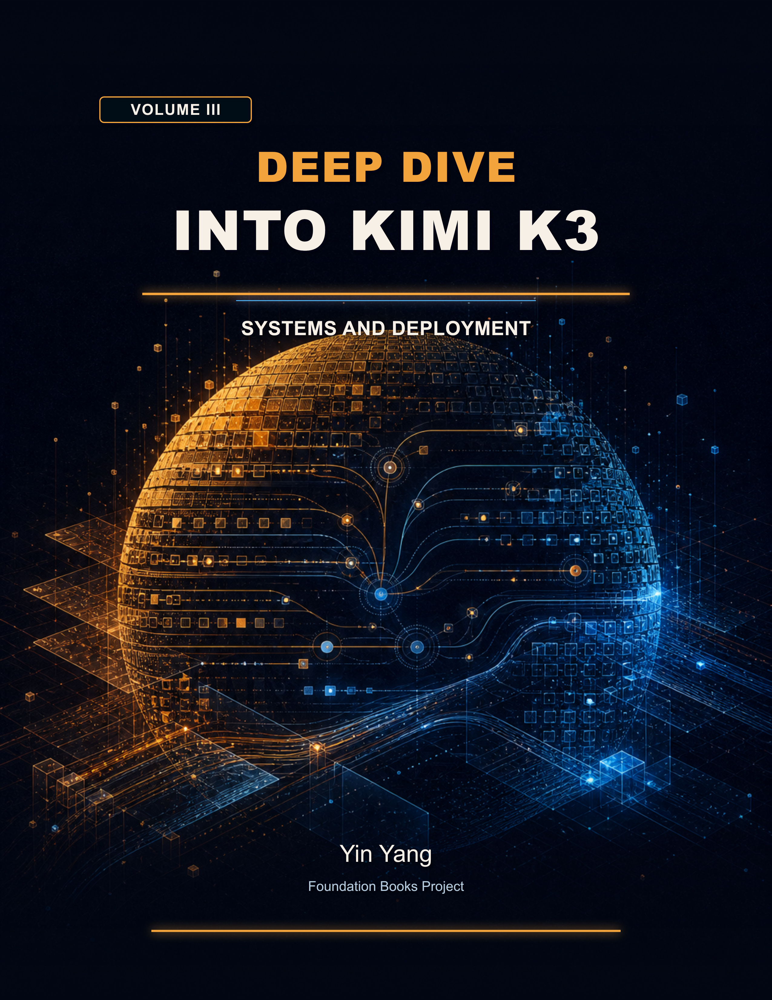

# Deep Dive into Kimi K3 Companion Code

This directory is the root of the reader-facing companion for
*Deep Dive into Kimi K3*. It contains small, dependency-free reference
implementations and selected executable experiments. The examples demonstrate
correctness, accounting and bounded comparisons; recorded hardware data comes
with its original scope and conditions.

<p>
  
  
  
</p>

## Book information

| Field | Details |
| --- | --- |
| Full title | Deep Dive into Kimi K3 |
| Edition | First Edition |
| Author | Yin Yang |
| Publication status | Ebook, paperback, and hardcover editions available on Amazon |
| Language | English |
| Publisher | Foundation Books Project |
| Series | Foundation Books |
| Volume I | Architecture and Pretraining |
| Volume I paperback ASIN | [B0HMMCM7WY](https://www.amazon.com/dp/B0HMMCM7WY) |
| Volume I hardcover ASIN | [B0HMMDDHM2](https://www.amazon.com/dp/B0HMMDDHM2) |
| Volume I ebook ASIN | [B0HMM6GVYP](https://www.amazon.com/dp/B0HMM6GVYP) |
| Volume II | Post-Training and Agent Intelligence |
| Volume II paperback ASIN | [B0HMMFNT6V](https://www.amazon.com/dp/B0HMMFNT6V) |
| Volume II hardcover ASIN | [B0HMNKKMRB](https://www.amazon.com/dp/B0HMNKKMRB) |
| Volume II ebook ASIN | [B0H968CP4Y](https://www.amazon.com/dp/B0H968CP4Y) |
| Volume III | Systems and Deployment |
| Volume III paperback ASIN | [B0HMNMNQHB](https://www.amazon.com/dp/B0HMNMNQHB) |
| Volume III hardcover ASIN | [B0HMNMF5D8](https://www.amazon.com/dp/B0HMNMF5D8) |
| Volume III ebook ASIN | [B0HMNM5MZZ](https://www.amazon.com/dp/B0HMNM5MZZ) |

The book calls this directory the *companion-code root*. Paths printed in the
book are relative to this directory. The examples are educational sample code;
`pyproject.toml` defines a reader environment rather than an installable Python
distribution. Understanding the published book does not require running them.

## Publication boundary

The public companion contains selected reference implementations, tests,
fixtures, and recorded-data analysis. The manuscript, extended research notes,
raw author experiment archives, upstream source checkouts, and publication
tooling stay in the author repository. [RELEASING.md](RELEASING.md) describes
the explicit inventory and local export command; the export makes this
directory the standalone repository root.

## Setup and checks

The directory can be checked independently from the manuscript source. Run
these commands from the companion-code root: `code/` in the book source
checkout, or the repository root in a standalone export. The smoke suite
requires Python 3.10–3.12 and Make:

```sh
make smoke
```

The [selected experiments](experiments/README.md) reproduce KDA and MoBA toy
calculations, analyze supplied Gated MLA numerical/cache observations on CPU,
and replay authored coding validation and recovery studies:

```sh
python3 -B -m experiments all --check
```

The smoke suite compiles every Python file without writing bytecode, validates
`chapter_coverage.json`, tests the coverage validator, and executes every
chapter test in every manifest-owned directory and the selected experiment
tests. No third-party Python packages are required.
It also rejects release-time secrets, machine-local paths, generated artifacts,
executed notebook state, and Python modules that exceed the standalone
readability budgets.
The local runner executes both `unittest` cases and zero-argument `test_*`
functions, and rejects files that accidentally contain no runnable tests.
Each chapter-test process has a 120-second limit. Set
`KIMI_COMPANION_TEST_TIMEOUT_SECONDS` or pass `--timeout-seconds` to the
coverage module when a slower environment needs an explicit override.

The seven Volume I Implementation-Insight Index comparisons have a separate
entry point, run from this companion's root directory:

```sh
python3 -B -m integrated_k3_transformer.implementation_insights
python3 -B _maintenance/chapter_test_runner.py integrated_k3_transformer/test_implementation_insights.py
```

| Printed investigation | Function in `integrated_k3_transformer/implementation_insights.py` |
| --- | --- |
| §3.3, routing weights | `routing_comparison` |
| §4.6, restored convolution history | `convolution_continuation` |
| §6.7, gated projection | `gate_comparison` |
| §7.3, raw depth values | `depth_value_comparison` |
| §10.1, ordered composition | `schedule_comparison` |
| §12.8, optimizer decay | `muon_decay_comparison` |
| §15.6, document isolation | `packed_target_loss` |

These are finite teaching reconstructions. Their printed output and analytical
tests supply the local run record; they do not execute the cited third-party
implementations. In a release export, `release-manifest.json` identifies the
edition's exact code bytes. The historical `system_correctness_performance`
package is also in the release inventory; its README gives the optional command transferred from the
former Appendix A.5, with this directory as the working directory.

For the complete standalone quality gate, install the optional pinned tools
and run the local aggregate:

```sh
poetry install --with quality
poetry run make quality-checks
```

That adds formatting, lint, static-type, and project-metadata checks without
depending on the manuscript repository. `make full-quality-checks` is an alias
for this standalone gate. The optional quality tools have exact version pins;
the smoke suite itself needs only Python and Make.

## Coverage

`chapter_coverage.json` is the machine-checked inventory of implemented
chapters with direct companion code. Every entry names one directory, reference
module, and uniquely named test module. In the source repository, an additional
contract checks its printed numbers and titles against chapter metadata. Adding
or removing a chapter companion requires updating that manifest.

The Volume II print mergers retain the existing companion identities and tests
while the active print sequence is renumbered contiguously. Historical donor
companions remain explicitly labeled below: the former Chapter 25 companion
supplies the training half of current Chapter 29; the former Chapter 29
companion supplies durable context in Chapter 28; and the former Chapter 32
companion supplies assurance in current Chapter 31.

Chapter 1, *Foundations: The Transformer That Kimi Builds On*, has its own
`transformer_foundations/` companion and registered test entrypoint. Its
complete tiny decoder and reverse-mode gradient witness run in the same smoke
suite as every other numbered chapter.

| Chapter | Reference |
| --- | --- |
| 1. Foundations: The Transformer That Kimi Builds On | `transformer_foundations/` |
| 2. Computational Anatomy of Kimi K3 | `computational_anatomy/` |
| 3. Sparse MoE from K2 to K3 | `sparse_moe/` |
| 4. Kimi Delta Attention | `kda/` |
| 5. Hybrid Attention in Kimi K3 | `kimi_linear/` |
| 6. Gated Multi-Head Latent Attention | `gated_mla/` |
| 7. Attention Residuals | `attention_residuals/` |
| 8. Stable LatentMoE | `stable_latent_moe/` |
| 9. MoonViT and Native Multimodality | `moonvit_native_multimodality/` |
| 10. The Integrated K3 Transformer | `integrated_k3_transformer/` |
| 11. Advanced Reading: MoBA and Learned Block-Sparse Attention | `moba/` |
| 12. Scaling Muon for LLM Training | `moonlight_muon/` |
| 13. MuonClip and Training Stability | `muonclip_training_stability/` |
| 14. Stable Sparse Pretraining | `stable_sparse_pretraining/` |
| 15. Long-Context Pretraining | `long_context_pretraining/` |
| 16. Native Multimodal Pretraining | `native_multimodal_pretraining/` |
| 17. Supervised Cold Start for Agentic RL | `k3_post_training_data_sft/` |
| 18. Reinforcement Learning Foundations: From Token Prediction to Outcome-Driven Learning | `rl_foundations/` |
| 19. Long-CoT Reinforcement Learning and Localized Policy Optimization | `long_cot_rl_policy_optimization/` |
| 20. Sampling, Curricula, and Partial Rollouts | `sampling_curricula_partial_rollouts/` |
| 21. Multi-Domain and Reasoning-Effort Reinforcement Learning | `multi_domain_reasoning_effort_rl/` |
| 22. Rewards, Verifiers, and Agentic Generative Reward Models | `rewards_verifiers_agentic_grm/` |
| 23. Capability Consolidation and Deployment-Aware Post-Training | `capability_consolidation_deployment_aware_post_training/` |
| 24. Unified Agentic Environments and Task Synthesis | `unified_agentic_environments_task_synthesis/` |
| 25. Visual and Multimodal Agent Learning | `visual_multimodal_agent_learning/` |
| 26. Parallel-Agent Reinforcement Learning and Agent Swarms | `parallel_agent_reinforcement_learning_agent_swarms/` |
| 27. Structured Generation, XTML, and Walle | `structured_generation_xtml_walle/` |
| 28. Tool Execution, Agent State, and Durable Context | `reasoning_state_tool_execution/` |
| 29. Coding Agents: Training and Execution | `kimi_code_test_grounded_software_engineering/` |
| 30. Case Study: Kernel Optimization as a K3 Reinforcement-Learning Domain | `kernel_optimization_learning/` |
| 31. Agent Evaluation, Correctness, and Safety | `evaluating_reasoning_agentic_systems/` |
| 32. From Basic CUDA to Kimi Kernels | `gpu_kernel_foundations/` |
| 33. LLM Parallelism Foundations: From One GPU to a Distributed Model | `llm_parallelism_foundations/` |
| 34. FlashKDA and KDA Kernels | `flashkda_kda_kernels/` |
| 35. Hybrid-Attention and Depth-Mixing Kernels | `hybrid_attention_depth_mixing_kernels/` |
| 36. MoE Kernels and Routed Computation | `moe_kernels_routed_computation/` |
| 37. MoonEP and Perfectly Balanced Expert Parallelism | `moonep/` |
| 38. Distributed Execution for K3-Class Models | `distributed_execution_k3_class_models/` |
| 39. Memory-Efficient Training | `memory_efficient_training/` |
| 40. Multimodal Encoder and Input-Pipeline Optimization | `multimodal_encoder_input_pipeline_optimization/` |
| 41. Checkpoint Engine and Online Weight Publication | `checkpoint_engine_online_weight_publication/` |
| 42. Million-Token Agentic-RL Infrastructure | `million_token_agentic_rl_infrastructure/` |
| 43. Mooncake and Disaggregated Serving | `mooncake_disaggregated_serving/` |
| 44. KDA-Aware Prefix Caching and Long-Context Scheduling | `kda_aware_prefix_caching/` |
| 45. Fleet Scheduling, Admission, and Failure Recovery | `fleet_scheduling_admission_failure_recovery/` |
| 46. Low-Precision Execution and Speculative Decoding | `low_precision_execution_speculative_decoding/` |

### Historical companion snapshots

These entries preserve code for material merged into an active chapter
or retained in the closing appendix. Their historical
labels do not consume a current chapter number. The former Chapter 45 supplies
the optional K3 validation checklist; the former Chapter 46 supplies the outlook's
finite models and the numerical-execution chapter's migration witness.

| Historical Chapter | Reference |
| --- | --- |
| Historical 25. Coding-Agent Training | `coding_agents_kimi_dev/` |
| Historical 29. Durable Agent Loops and Context Management | `durable_agent_loops_context_management/` |
| Historical 32. Agent Correctness, Failure, Safety, and Frontiers | `agent_correctness_failure_safety_frontiers/` |
| Historical 45. System Correctness and Performance | `system_correctness_performance/` |
| Historical 46. Open Systems Problems | `open_systems_problems/` |

Chapter 30's kernel-optimization companion supplies a CPU oracle, a closed
assigned-cost candidate selection with held-out checks, and a finite policy
calculation. Its controlled pinned-source probes and GPU study protocol remain
in the author's research archive.

The Chapter 33 parallelism companion checks two-/four-rank arithmetic, pipeline dependency
order, route restoration, and sequence boundaries on a CPU. It reuses the
Chapter 38 tensor-parallel and affine-composition witnesses.
Its communication examples also check four-rank collective composition,
nonlinear row mixing, the all-gather pullback, unequal/empty route buckets,
exclusive prefixes, and finite readiness/reuse traces.

The Chapter 32 kernel bridge supplies an exact Python warp-reduction oracle. Its
optional CUDA teaching program has a separate validation status documented in
the chapter companion's README and is not required by the standalone suite.
The Chapter 29 controlled dashboard is also optional. Its browser evaluator
requires Node v24.7.0 and Chrome 153.0.8010.53; the ordinary smoke suite does
not launch a browser. See the dashboard's README for its separate commands and
captured-output scope.
Historical merged snapshots remain listed separately so their source identities
and tests stay executable without presenting them as current print chapters.

The standalone export's `release-manifest.json` lists the source commit and SHA-256
hash of every exported file; the hashes identify these exact bytes when the
source checkout contains local changes. The full author evidence archive, source
pins, manuscript, and publication tooling remain outside this reader-facing
tree.

## License

The original companion code and documentation in this directory are available
under the MIT license; see [LICENSE](LICENSE). Copyright (c) 2026 Yin Yang.
See [NOTICE.md](NOTICE.md) for cover artwork, supplied evidence, and third-party
source limitations.
